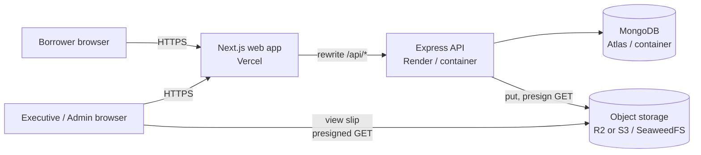
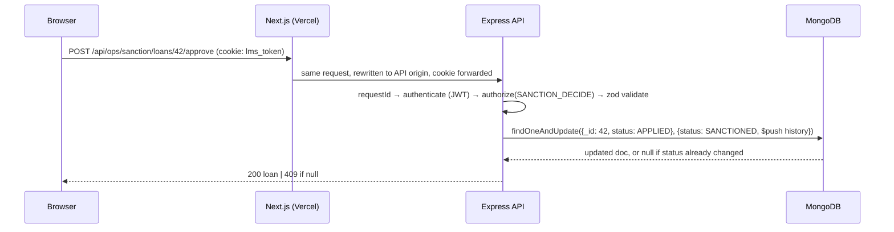

# 01 — High-Level Design

## System context

Four runtime pieces. Only the API talks to MongoDB. Uploads go through the API into object storage.
Executives view a slip directly from storage with a short-lived URL the API signs after checking their role.

## Containers and responsibilities

| Container | Responsibility | Does NOT do |
|---|---|---|
| Next.js web | Pages, forms, sliders, live SI preview, route guards for UX, proxy `/api/*` to API | Business decisions. Every rule is re-checked by the API. |
| Express API | Auth, RBAC, BRE, loan math, state transitions, payment recording, validating uploads and passing them to storage, signing view URLs | Keeping files on its own disk |
| MongoDB | Users, loans, payments. Unique indexes enforce UTR and email uniqueness. Transactions for payment + close. | — |
| Object storage | Salary slip bytes, private bucket | Access decisions. It trusts the signature only. |

## Request path for an authenticated call

Why the rewrite: the browser only ever sees the Vercel origin, so the auth cookie is first-party
(`SameSite=Lax`) and no CORS is needed. Full reasoning and browser matrix in `adr/0001`.

## Salary slip upload path

1. Browser sends `multipart/form-data` to `POST /api/borrower/salary-slip`.
2. Multer reads the file into memory with `limits.fileSize = 5 MB`. A bigger file is cut off at 5 MB and rejected (422),
   so a liar cannot make the API buffer more than that.
3. API checks the real type from the first bytes (magic bytes: `%PDF`, `FF D8 FF`, `89 50 4E 47`), not the file name or the
   browser's `Content-Type`.
4. API uploads the buffer to the bucket under a server-chosen key, saves `{key, mime, size}` on the borrower, and frees the buffer.
   The API disk is never touched.

Details and alternatives in `adr/0002`.

## Why this shape scales

| Concern | How the design handles it |
|---|---|
| More API traffic | API is stateless: JWT in cookie, files in object storage, no server sessions, no local disk. Add instances behind a load balancer. |
| Large uploads | Max 5 MB held in memory for one request, then sent to storage. At 100 concurrent uploads that is ≤ 500 MB RAM; past that, move to presigned direct upload (ADR 0002, option 4). |
| Read-heavy dashboards | Each module list is one indexed query: `loans {status, createdAt}`, `users {role, onboardingStage}`. Paginated. |
| Write correctness under concurrency | Status changes are conditional updates on the expected current status. Payments use a transaction plus a unique UTR index. Two execs clicking at once cannot double-approve or double-close. |
| Future notifications (SMS on disbursal) | Write an `outbox` document in the same transaction, a worker publishes it. Not built now, listed as next step. |
| Audit | `statusHistory` on each loan records who moved it, from what, to what, when. |

## Environments

| | Local (Docker Compose) | Live |
|---|---|---|
| Web | `web` container (Next.js standalone) | Vercel |
| API | `api` container | Render (same Dockerfile) |
| Mongo | `mongo` container, single-node replica set `rs0` (needed for transactions) | Atlas free tier (replica set by default) |
| Storage | SeaweedFS container (S3 API), private bucket created by the API at boot in dev | R2 or S3, decided at deploy time |
| Seed | one-shot `seed` container | run once from local against Atlas |

Same code everywhere. Only environment variables change: `MONGO_URI`, `S3_ENDPOINT`, `S3_BUCKET`, keys, `JWT_SECRET`.
