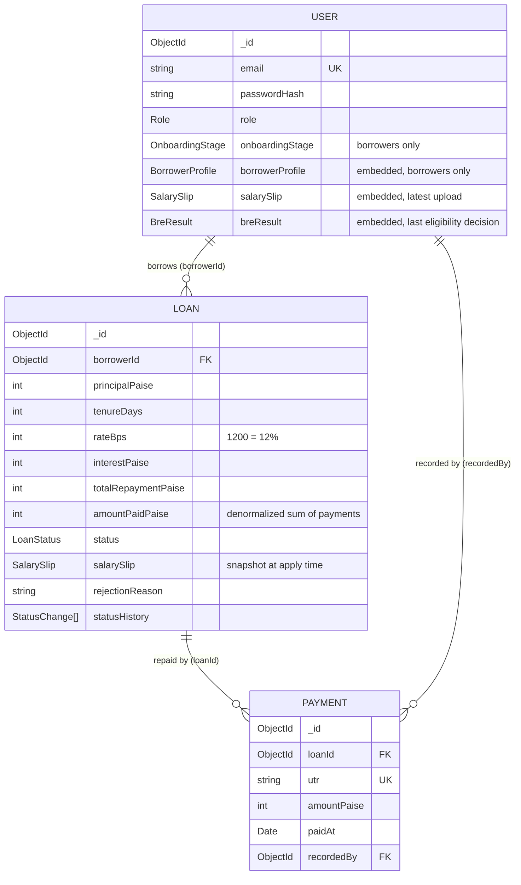

# 02 — Domain Model

## Collections at a glance



Three collections: `users`, `loans`, `payments`. Why not more:

- **Borrower profile is embedded in `users`, not a separate `profiles` collection.** It is 1:1 with the user,
  always read together, and small. Embedding saves a join on every borrower page.
- **No `applications` collection.** The pre-loan journey (details → slip) is tracked by `onboardingStage` on the user.
  The loan document is created only on Apply. Sales reads leads from `users`.
- **Payments are their own collection, not an array inside the loan.** A unique index on an array field
  (`loans.payments.utr`) does block the same UTR on two *different* loans, but it does NOT block the same UTR
  twice inside *one* loan's array: Mongo checks uniqueness between documents, not within one document.
  A separate collection with a plain unique index on `utr` closes both gaps. It also keeps the loan document
  small (an embedded array grows with every payment) and lets Collection query payments on their own.

### Why the loan has no `paymentIds` array
The link is stored on the child: each payment has `loanId`. The loan stores no list of payment IDs.

```
loans                          payments
{ _id: L1, status, ... }  <──  { _id: P1, loanId: L1, utr, amountPaise }
                          <──  { _id: P2, loanId: L1, utr, amountPaise }
```
"Payments of loan L1" = `payments.find({ loanId: L1 })`, served by index `{loanId: 1, paidAt: 1}`.

Why not also keep `paymentIds: [P1, P2]` on the loan:
- **Two writes for one fact.** The array and the payments would have to be kept in sync forever. Miss one and they disagree.
- **Unbounded array.** It grows with every payment. MongoDB's own modelling guide calls this the
  "one-to-many with many" case and says to reference the parent from the child.
- **No reader needs it.** Screens need either the total paid (stored as `amountPaidPaise`) or the full payment rows
  (the `loanId` query). A list of bare IDs helps neither.

This is the same as a SQL foreign key: `payments.loan_id REFERENCES loans(id)`. A bank does the same: the account
holds a balance, and each transaction row points to the account. The account never lists its transactions.
Each payment still has its own `_id`. It is just not copied onto the loan.

## Enums

```ts
enum Role { ADMIN, SALES, SANCTION, DISBURSEMENT, COLLECTION, BORROWER }
enum EmploymentMode { SALARIED, SELF_EMPLOYED, UNEMPLOYED }
enum OnboardingStage { REGISTERED, DETAILS_SUBMITTED, BRE_REJECTED, SLIP_UPLOADED, APPLIED }
enum LoanStatus { APPLIED, SANCTIONED, REJECTED, DISBURSED, CLOSED }
```

Rule from the LLD guide: a fixed set of values is an enum, never a free string. Mongoose gets
`enum: Object.values(LoanStatus)` so the database rejects typos too.

## Field-level decisions

### Money is integer paise
`₹1,00,000` is stored as `10000000`. JavaScript numbers are floats: `0.1 + 0.2 !== 0.3`.
Summing payments in rupees with decimals drifts by fractions of a paisa and the "paid == total" check
for auto-close can fail by `0.0000001`. Integers up to 2^53 are exact, far beyond any loan here.
Formatting to rupees happens only in the UI. See `adr/0003`.

### Currency stored next to every amount
Every money-bearing document has `currency: 'INR'`, like Razorpay and Stripe send `amount` + `currency` together.
INR only today, but an amount without a currency is ambiguous the day a second one appears.
In code, amounts go through a `Money` value object (`Money.ofPaise(n)`, `add`, `subtract`, `equals`, `format()`),
Martin Fowler's Money pattern: arithmetic on raw numbers is not allowed in services.

### Interest rate stored on the loan (`rateBps: 1200`)
The rate is fixed at 12% today. Storing it per loan means that if the rate changes next year, old loans
still compute correctly. Basis points (1 bps = 0.01%) keep it an integer.

### Computed fields are stored, not recomputed on read
`interestPaise` and `totalRepaymentPaise` are computed once on Apply and saved. A loan's contract
must not change if the formula or rounding code changes later.

### `amountPaidPaise` is denormalized
Source of truth = sum of `payments.amountPaise` for the loan. We also keep a running total on the loan so
the Collection list shows outstanding without aggregating payments for every row.
Both are written in the same transaction, so they cannot drift. The `loan-math-verifier` agent re-checks it.

Outstanding is never stored: `outstanding = totalRepaymentPaise − amountPaidPaise`. Storing it would be a
third number to keep in sync.

### Salary slip lives in two places
- `users.salarySlip` = latest upload, used by the borrower flow.
- `loans.salarySlip` = copy taken at Apply time.
If the borrower reapplies later with a new slip, the old loan still points at the slip it was approved on.
This is the snapshot pattern: a business record freezes the data it was based on.

### PAN
- Stored uppercase. Regex `^[A-Z]{5}[0-9]{4}[A-Z]$`: 5 letters, 4 digits, 1 letter.
- The 4th letter is the holder type: `P` person, `C` company, `H` HUF, `F` firm, and others.
  A personal loan should only go to an individual, so a strict check is `^[A-Z]{3}P[A-Z][0-9]{4}[A-Z]$`.
  The spec says "valid PAN format", so the BRE uses the general regex. The strict variant is one line in the
  rule list if the business asks for it. We mention it in the README to show we know.
- Unique index on `borrowerProfile.pan`, partial on `breResult.passed: true`: one PAN, one eligible borrower account. A rejected attempt (often a typo) does not claim the PAN, so it cannot block the real owner.

### BRE decision record
```ts
type BreResult = { passed: boolean; failures: { rule: string; message: string }[]; rulesVersion: number; facts: { age: number; monthlySalary: number; employmentMode: string }; evaluatedAt: Date };
```
`users.breResult` holds the latest result, overwritten on each check. Sales sees why a lead is stuck at `BRE_REJECTED`, and
support can explain a rejection even after the thresholds change. See `adr/0004`.

### Status history
```ts
type StatusChange = { from: LoanStatus | null; to: LoanStatus; by: ObjectId | 'SYSTEM'; at: Date; note?: string };
```
Gives an audit trail and powers a timeline on the loan detail page. Timestamps like `sanctionedAt`
and `disbursedAt` are also stored as top-level fields because queries and payment validation use them.

## Indexes, traced from the read side

| Screen / operation | Query | Index |
|---|---|---|
| Login | `users.findOne({email})` | `{email: 1}` unique |
| Sales leads | `users.find({role: BORROWER, onboardingStage: {$ne: APPLIED}}).sort({createdAt: -1})` | `{role: 1, onboardingStage: 1, createdAt: -1}` |
| Sanction / Disbursement / Collection lists | `loans.find({status}).sort({createdAt: -1})` | `{status: 1, createdAt: -1}` |
| Borrower "my loans" | `loans.find({borrowerId})` | `{borrowerId: 1, createdAt: -1}` |
| One open loan per borrower | — | `{borrowerId: 1}` unique, partial: `status ∈ {APPLIED, SANCTIONED, DISBURSED}` |
| Duplicate UTR | — | `{utr: 1}` unique |
| Payments of a loan | `payments.find({loanId}).sort({paidAt: 1})` | `{loanId: 1, paidAt: 1}` |

Note on Sales: once a borrower's loan is REJECTED or CLOSED they can reapply. Their stage goes back to
`SLIP_UPLOADED` on reject/close so they show as a lead again. That is a deliberate product choice.
