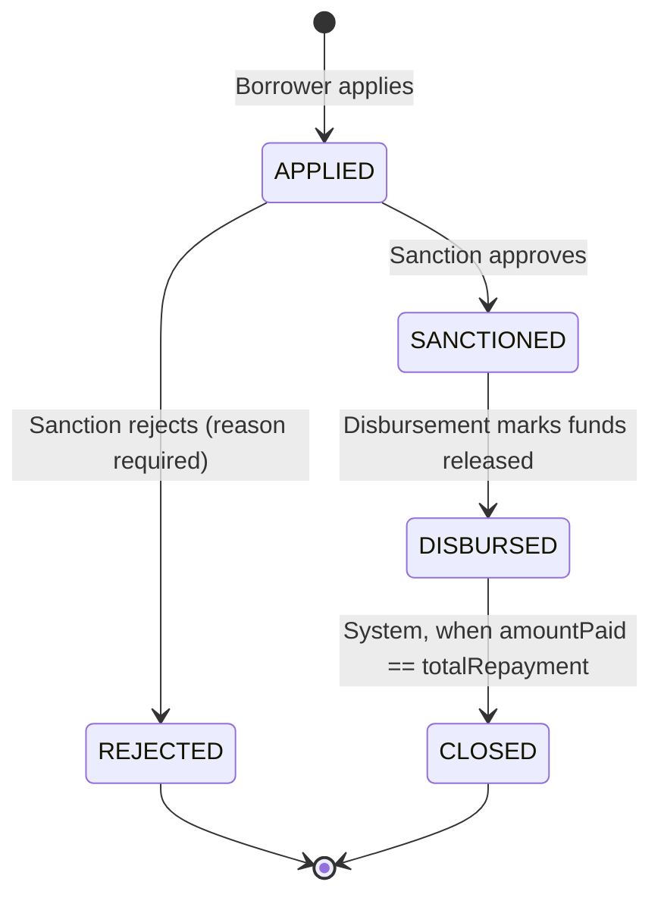

# 03 — Loan State Machine

## States and transitions



`REJECTED` and `CLOSED` are terminal. Nothing moves a loan out of them. A borrower who wants another loan
creates a new loan document.

## Transition table (this is the code, not just the doc)

| From | To | Triggered by | Guard | Side effects |
|---|---|---|---|---|
| — | APPLIED | BORROWER | stage = SLIP_UPLOADED, no open loan, amount and tenure in range | compute interest + total, snapshot slip, stage → APPLIED |
| APPLIED | SANCTIONED | SANCTION, ADMIN | — | `sanctionedAt`, `sanctionedBy` |
| APPLIED | REJECTED | SANCTION, ADMIN | `reason` non-empty, ≤ 500 chars | `rejectionReason`, borrower stage → SLIP_UPLOADED |
| SANCTIONED | DISBURSED | DISBURSEMENT, ADMIN | — | `disbursedAt`, `disbursedBy` |
| DISBURSED | CLOSED | SYSTEM | `amountPaidPaise == totalRepaymentPaise` | `closedAt`, borrower stage → SLIP_UPLOADED |

In code this table is a constant:

```ts
const TRANSITIONS = [
  { from: LoanStatus.APPLIED,    to: LoanStatus.SANCTIONED, by: [Role.SANCTION, Role.ADMIN] },
  { from: LoanStatus.APPLIED,    to: LoanStatus.REJECTED,   by: [Role.SANCTION, Role.ADMIN] },
  { from: LoanStatus.SANCTIONED, to: LoanStatus.DISBURSED,  by: [Role.DISBURSEMENT, Role.ADMIN] },
  { from: LoanStatus.DISBURSED,  to: LoanStatus.CLOSED,     by: ['SYSTEM'] },
] as const;
```

One function `assertTransition(from, to, actor)` checks it. Services call it before any status write.
Adding a new state later (say `WRITTEN_OFF`) is one new row, not edits scattered across controllers.
This is the **State pattern** in its table-driven form. A class per state is overkill for five states
with no per-state behavior beyond "which moves are allowed".

## Why CLOSED is SYSTEM-only

The spec says "auto-close". If a human could close a loan, a collection exec could close a loan with
money still owed. Closing happens only inside the record-payment transaction, when the math says so.

## Concurrency: two people click at the same time

Problem: Sanction exec A clicks Approve, Sanction exec B clicks Reject on the same loan, same second.
A naive service does `find` → check status → `save`. Both reads see `APPLIED`, both writes succeed,
last write wins, history is wrong.

Fix: make the check and the write one atomic operation.

```ts
const updated = await Loan.findOneAndUpdate(
  { _id: loanId, status: LoanStatus.APPLIED },          // expected current state
  { $set: { status: LoanStatus.SANCTIONED, sanctionedAt: now }, $push: { statusHistory: change } },
  { new: true },
);
if (!updated) throw new ConflictError('Loan is no longer in APPLIED state');   // → 409
```

Mongo applies a single-document update atomically. The second click finds no document matching
`status: APPLIED` and gets 409. This is **optimistic concurrency** with the status field as the version.

## Payment + auto-close in one transaction

```
session.withTransaction:
  loan = Loan.findOne({_id, status: DISBURSED})           // 409 if not disbursed
  validate amount ≤ total − paid, paidAt in [disbursedAt, today]   // 422 if not
  Payment.create({loanId, utr, amountPaise, paidAt})      // 409 on duplicate utr (E11000)
  Loan.updateOne({_id}, {$inc: {amountPaidPaise: amount}})
  if new paid == total: set status CLOSED, closedAt, push history (by: SYSTEM)
```

Concurrent payments: if two transactions update the same loan, Mongo aborts one with a `WriteConflict`.
`withTransaction` retries it from the top. The retry re-reads the loan, sees the smaller outstanding,
and fails validation with 422 if the second payment no longer fits.

Why a transaction: without it, a crash between "insert payment" and "increment loan" leaves a payment
the loan does not know about. With it, either everything commits or nothing does.
